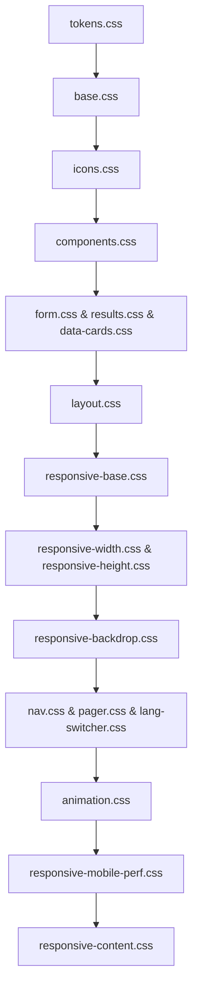
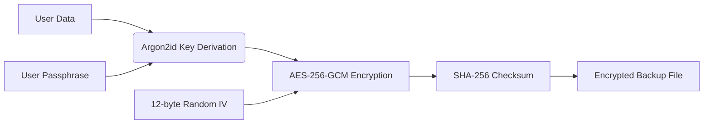

# BMI Stellar — Architectural Deep Dive

This document is the canonical technical reference for BMI Stellar. It covers architecture decisions, internal systems, and design constraints at a depth intended for contributors, security auditors, and maintainers who need to understand _why_ the code works the way it does — not just _what_ it does.

---

## Table of Contents

- [Highlights](#highlights)
- [CSS Architecture](#css-architecture)
- [Accessibility Architecture](#accessibility-architecture)
- [Pager Navigation](#pager-navigation)
- [Animation & Performance Tiers](#animation--performance-tiers)
- [Lazy Loading](#lazy-loading)
- [Data Persistence](#data-persistence)
- [Encryption System](#encryption-system)
- [Internationalization](#internationalization)
- [Share Image Generation](#share-image-generation)
- [Progressive Web App](#progressive-web-app)
- [CI/CD Workflows](#cicd-workflows)
- [Release Process](#release-process)
- [Known Constraints](#known-constraints)

---

## Highlights

- **Instant Insights:** Immediate BMI results with precise category classification, health advice, BMI Prime, ideal weight range, and body-fat estimates — all computed locally with zero network calls.
- **TDEE Estimator:** Comprehensive Total Daily Energy Expenditure estimator with gender toggle and five activity levels (Sedentary, Light, Moderate, Active, Very Active), context-aware captions, and kcal/day display.
- **Goal Tracking:** Advanced goal tracker comparing current, best, and target states with trend sparklines and directional badges.
- **Rich Visuals:** Interactive radial gauge, BMI history sparkline with hover tooltips, and premium share card generation via Canvas API.
- **Secure Backups:** Passphrase-encrypted backups using AES-256-GCM with Argon2id key derivation, SHA-256 integrity checksums, and zero-knowledge passphrase verification.
- **Global Reach:** Multi-language UI spanning English, Indonesian, Japanese, and Chinese — with universal unit symbols (kg, cm, lb, in, kcal) and locale-aware text rendering.
- **Performance Optimized:** Three-tier animation system (high/medium/low) that adapts to device capability, strict touch intent detection, and touch-device CSS that reduces expensive paint work in scroll-heavy views.
- **Accessibility First:** Keyboard-visible focus states, ARIA dialog/radiogroup/alert patterns, keyboard navigation, `prefers-reduced-motion` support, and screen-reader-friendly labels throughout.

## CSS Architecture

Styles are modularized under `src/styles/` and imported in a strict cascade order from `src/routes/+layout.svelte`. The cascade follows a deliberate layering strategy — each layer builds on the previous, with `responsive-content.css` as the ultimate override.



| #   | File                         | Responsibility                                                                                                                                                                    |
| --- | ---------------------------- | --------------------------------------------------------------------------------------------------------------------------------------------------------------------------------- |
| 1   | `tokens.css`                 | Fonts (`@font-face` Inter Variable + JetBrains Mono), colors, spacing, radius, timing, z-index, glassmorphism tokens, deep-void gradients, and all semantic CSS custom properties |
| 2   | `base.css`                   | Global reset, scrollbar hiding, selection color, typography scale, utility classes                                                                                                |
| 3   | `icons.css`                  | Lucide icon fluid sizing via `clamp()`, semantic icon colors                                                                                                                      |
| 4   | `components.css`             | Central glassmorphism containers, button system (6 variants), hero base styles, toast/notify                                                                                      |
| 5   | `form.css`                   | BMI form layout, input validation, pill indicators, autofill fixes, unit system toggle                                                                                            |
| 6   | `results.css`                | BMI results card, share/action/download buttons, empty states, category badges                                                                                                    |
| 7   | `data-cards.css`             | Stat grid, TDEE panel, radial gauge, reference table, goal tracker                                                                                                                |
| 8   | `layout.css`                 | About section, wallpaper layout, footer, disclaimer                                                                                                                               |
| 9   | `responsive-base.css`        | Shared responsive contracts, fluid media, container sizing, form width breakpoints, and component-specific focus contracts                                                        |
| 10  | `responsive-width.css`       | Width breakpoints (768px, ultrawide) and surface sizing                                                                                                                           |
| 11  | `responsive-height.css`      | Height-based compression rules (640px, 520px)                                                                                                                                     |
| 12  | `responsive-backdrop.css`    | `@supports` feature detection for `backdrop-filter`, solid fallback backgrounds                                                                                                   |
| 13  | `nav.css`                    | Pager navigation, bottom controls, performance-tier GPU containment                                                                                                               |
| 14  | `pager.css`                  | Pager section layout, scroll-snap container, section transitions, and pager-specific responsive overrides                                                                         |
| 15  | `lang-switcher.css`          | Floating language switcher panel (portal-aware global styles)                                                                                                                     |
| 16  | `animation.css`              | Skeleton loading, shooting stars, input focus glow, glass card hover sweeps, progress bars                                                                                        |
| 17  | `responsive-mobile-perf.css` | Touch-device scroll/tap/rendering overrides — disables `backdrop-filter`, simplifies transitions on `(hover: none) and (pointer: coarse)`                                         |
| 18  | `responsive-content.css`     | Final correction layer for widths, rhythm, radius, and shadow policy                                                                                                              |

## Accessibility Architecture

BMI Stellar follows a **component-owned focus pattern**: mouse focus is suppressed (`:focus:not(:focus-visible) { outline: none }`), while keyboard focus is exposed through each component's own visible indicator. Inputs, segmented controls, modal controls, icon buttons, and pager controls use local focus styles rather than a single global purple outline. This keeps keyboard navigation visible without producing inconsistent rings on floating windows or notification controls.

**ARIA patterns in use:**

| Pattern                                               | Components                                                                   |
| ----------------------------------------------------- | ---------------------------------------------------------------------------- |
| `role="dialog"` + `aria-modal="true"` + `aria-label`  | ModalShell, EncryptionModal, LanguageSwitcher, DebugPanel                    |
| `role="radiogroup"` + `role="radio"` + `aria-checked` | UnitSystemToggle, OptionalMetrics (gender + activity), BodyFatEstimate (sex) |
| `aria-invalid` / `aria-disabled` / `aria-busy`        | BmiForm calculate button, input fields                                       |
| `role="alert"`                                        | Validation error messages                                                    |
| `role="status"` + `aria-live="polite"`                | BmiResults (announces calculation results)                                   |
| `aria-current="page"`                                 | Active pager section indicator                                               |
| `role="img"` + `aria-label`                           | Sparkline SVG chart                                                          |
| `aria-hidden="true"`                                  | All decorative icons, dot indicators, spacers                                |

**Reduced motion:** `prefers-reduced-motion: reduce` disables non-functional movement via `animation-config.ts` and CSS media queries. Functional state changes remain available, but decorative motion is removed or reduced.

## Pager Navigation

The application is a single-page experience segmented into six primary sections: Welcome → Calculator → Gauge → Reference → About → Info. Navigation is supported via:

- **Top tabs** — direct section access
- **Bottom prev/next controls** — sequential navigation
- **Keyboard arrow keys** — Left/Right arrows
- **Hash routing** — URL fragment maps to section (`/#calculator`, `/#gauge`)
- **Wheel navigation** — Desktop horizontal wheel gestures with cooldown (520ms), direction threshold (60px dx, max 12px dy), and scroll-state awareness
- **Horizontal swipe** — Touch devices with strict gesture intent detection

> [!NOTE]
> Mobile vertical scrolling remains native. Horizontal navigation is intentionally strict — diagonal or vertical swipes will not accidentally trigger page transitions. The gesture intent system requires 16px of directional movement before committing to horizontal or vertical mode.

**Touch swipe criteria** (`touch-pager.ts`):

- Horizontal dominant (angle ratio > 2.05)
- Minimum swipe distance: 96px
- Maximum gesture duration: 420ms
- Post-navigation cooldown: 520ms
- Vertical intent threshold: 16px
- Vertical scroll cancellation threshold: 28px
- Recent touch-scroll guard: 480ms (`SCROLL.TOUCH_SCROLL_MODE_IDLE_DELAY`)
- Excluded targets: buttons, links, inputs, labels, and `[role="button"]` elements
- Haptic feedback: 5ms vibration on successful navigation

## Animation & Performance Tiers

`animation-config.ts` implements a three-tier animation system that adapts to device capability at runtime:

| Tier       | Criteria                                           | Marker Duration | Pager Duration | Gauge Tween |
| ---------- | -------------------------------------------------- | --------------- | -------------- | ----------- |
| **High**   | cores >= 8 AND memory >= 8 GiB AND (4g or offline) | 860ms           | 360ms          | 1200ms      |
| **Medium** | cores >= 4 AND memory >= 4 GiB                     | 780ms           | 340ms          | 900ms       |
| **Low**    | everything else                                    | 680ms           | 320ms          | 420ms       |

The default tier is **medium** (applied when hardware APIs are unavailable or during SSR). Navigation styles in `nav.css` apply GPU containment (`contain: layout style paint`) on high-tier devices and disable `backdrop-filter` on low-tier.

All animation constants are `as const` with invariants enforced by tests (e.g., `WHEEL_RECENT_SCROLL_BLOCK_MS < WHEEL_COOLDOWN`).

## Lazy Loading

Heavy components are loaded on-demand as their sections enter the viewport, ensuring a fast First Contentful Paint. The lazy-load registry in `src/routes/+page.svelte` is:

- `calculatorLoader` (paired) — `BmiForm` + `BmiResults`
- `gaugeLoader` — `BmiRadialGauge`
- `healthRiskLoader` — `BmiHealthRisk`
- `snapshotLoader` — `BmiSnapshot`
- `bodyFatLoader` — `BodyFatEstimate`
- `referenceLoader` — `ReferenceTable` (eagerly preloaded when the Reference section index is approaching)
- `goalTrackerLoader` — `BmiGoalTracker`

`DebugPanel` is **not** lazy-loaded — it is statically imported but only rendered in development mode.

The lazy-load utility (`src/lib/utils/lazy-load.ts`) uses `IntersectionObserver` with a small root margin to preload slightly before the section becomes visible.

## Data Persistence

All data remains client-side, managed via a storage abstraction layer (`src/lib/utils/storage.ts`): IndexedDB (via `src/lib/utils/db.ts`) is the durable primary store and localStorage is the synchronous write-through mirror in front of an in-memory read cache. The full set of `STORAGE_KEYS` defined in `src/lib/utils/storage.ts` is:

| Storage Key             | Store                    | Purpose                                                                                |
| ----------------------- | ------------------------ | -------------------------------------------------------------------------------------- |
| `bmi.history`           | localStorage + IndexedDB | Comprehensive BMI calculation history                                                  |
| `bmi.goal`              | localStorage + IndexedDB | User's target BMI / weight goal                                                        |
| `bmi.goal.start`        | localStorage + IndexedDB | Goal start reference (baseline for progress)                                           |
| `bmi.unitSystem`        | localStorage + IndexedDB | User metric/imperial preference                                                        |
| `bmi.locale`            | localStorage + IndexedDB | Selected language                                                                      |
| `bmi.wallpaperTheme`    | localStorage + IndexedDB | Selected wallpaper theme                                                               |
| `bmi.passphrase_hint`   | localStorage + IndexedDB | Optional user-written passphrase hint (never the passphrase itself)                    |
| `bmi.updateCheckAt`     | localStorage only        | Last automatic update-check timestamp (the 12-hour throttle stamp)                     |
| `__encryption_verifier` | IndexedDB `meta` store   | AES-GCM ciphertext of a known verifier string (confirms passphrase without storing it) |
| `__schema_version`      | IndexedDB `meta` store   | Storage schema version marker for migrations                                           |

> [!TIP]
> The storage layer includes error-resilient fallbacks — `SecurityError`, `QuotaExceededError`, and JSON parse failures are caught gracefully with dev-only warnings. Cross-tab consistency is enforced by the single-writer law (night-frontier-Z5): every legit ledger write holds the origin-wide Web Lock (`bmi-ledger-write`) as one critical section — freshness refresh, validated read, merge, mirror write, and the witness reseat/seal drain — while foreign-tab storage events drop stale health-key cache entries (`src/lib/utils/storage-coherence.ts`). The encryption verifier lives in the IndexedDB `meta` store (not localStorage) and is never the passphrase itself — only an authenticated ciphertext that can be tested against a candidate passphrase.

## Encryption System

The backup ecosystem is designed with zero-trust principles. No passphrase is ever stored or cached.



### Argon2id (Primary KDF)

Parameters follow OWASP 2023 recommendations. The derivation engine is the
Rust wasm artifact compiled from `engine/argon2id` (digest-verified before
use, provenance-checked against the crate in CI by `wasm-provenance.sh`);
the pure-JS `@noble/hashes/argon2.js` engine remains as the fallback for
any engine load or derive failure. Both engines implement standard Argon2id
(RFC 9106) and are pinned byte-identical by the known-answer and cross-check
suites, so the derived key does not depend on which path ran.

| Parameter     | Production         | Test (CI) |
| ------------- | ------------------ | --------- |
| Memory        | 64 MiB             | 1 MiB     |
| Iterations    | 3                  | 1         |
| Parallelism   | 1                  | 1         |
| Output length | 32 bytes (AES-256) | 32 bytes  |

### OPFS flush() Vault Tier (night-frontier-Z4)

`durability: 'strict'` is a hint; `FileSystemSyncAccessHandle.flush()`
is the fsync-shaped primitive. The latest rolling snapshot mirrors into
the origin's private file system (`vault-backup.json`) through a worker:
write → `flush()` → `close()`, single-flight, fire-and-forget. The
IndexedDB rotation stays primary; the vault is the fallback home the
restore path uses when the rotation is empty or unreadable. The
storage-inventory law enumerates the OPFS root in the same commit.

| Aspect   | Contract                                                                |
| -------- | ----------------------------------------------------------------------- |
| File     | exactly `vault-backup.json` at the OPFS root (P3 asserts the inventory) |
| Write    | sync access handle in the worker; flush before close, structurally      |
| Read     | `getFile().text()` on the main thread — no worker needed                |
| Fallback | restore uses the vault when the IndexedDB rotation is gone              |
| Degrade  | engines without sync handles: IndexedDB-only vault, honestly reported   |

### Device-Tier Argon2id Ladder (night-frontier-Z4)

The derivation rung scales from the capability engine
(`getPerformanceTier`): high 64 MiB / t3, medium 32 MiB / t3, low
19 MiB / t2 — the OWASP floor (m ≥ 19456 KiB, t ≥ 2, p ≥ 1) clamps
every rung, and read-side caps (1 GiB / t64 / p8) refuse absurd
parameters fail-closed. The finding that makes it safe: `kdfParams`
was recorded in envelopes but never used by decrypt — the fixed bundle
options made it decoration. Decrypt now honors the envelope's rung
(the writer's), and the at-rest session anchors on the stored
verifier's rung, so a tier change between sessions never re-derives a
different key from the sealed ledger. Pre-ladder envelopes decrypt
with the fixed legacy defaults (64 MiB / t3) they were written with.

### Ledger Continuity Chain (night-frontier-Z3)

The physics gap the envelope stack leaves open: AES-GCM protects per-value
and the HMAC protects per-file, but nothing protects the _sequence_. The
continuity chain closes it. Construction, stated exactly:

```
link_0 = SHA-256("bmi-stellar-ledger-v4-genesis")
link_i = SHA-256(link_{i-1} + ":" + canonical(record_i))        (plain mode)
link_i = HMAC-SHA256(K_w, link_{i-1} + ":" + canonical(record_i)) (keyed mode)
head   = link_n   (canonical: fixed key order timestamp/bmi/height/weight/age,
                   ascending timestamp, stable sort)
```

| Aspect  | Contract                                                                                                                                        |
| ------- | ----------------------------------------------------------------------------------------------------------------------------------------------- |
| Witness | `{ head, length }` sealed in IndexedDB meta `__history_chain_head`; a keyed witness carries `mode: 'keyed'` and the public key fingerprint `kf` |
| Re-seal | Only legit writes: save (pre-state must match), import, clear                                                                                   |
| Freeze  | A save over a mismatched pre-state does NOT re-seal - evidence is preserved                                                                     |
| Export  | v4 envelope carries the PLAIN `chain` inside the HMAC payload; import cross-checks it (portable, keyless)                                       |
| Backup  | The witness travels inside the backup snapshot; restore re-installs it                                                                          |
| Audit   | ok / violated / unanchored / sealed-opaque (locked sealed ledger) / witness-opaque (keyed witness without its key)                              |

**The keyed witness law (night-frontier-Z6).** For a passphrase-protected
ledger the device witness is a keyed chain: every record link runs under
the witness attestation key, an HKDF-SHA256 subkey (info
`bmi-stellar-witness-mac-v1`, salted with the per-device at-rest salt)
derived in the SAME Argon2id pass that builds the session seal key — one
derivation, two purposes, zero extra 64 MiB burns. The key installs at
every passphrase-proven registration (the verifier moments) and is
wiped, not dropped, on lock. The physics upgrade: a party who rewrites
both the history and the meta store can no longer re-seal the device
witness — computing the next link requires the key, and the key requires
the passphrase. The reseat path recomputes the pre-state under the
SEALED witness's mode (never the current one), verifies the fingerprint
belongs to the same passphrase, and upgrades a plain witness to keyed on
the first legit save after an unlock. A keyed witness whose key is gone
(locked edge, passphrase rotation) steps aside to honestly unanchored —
it can neither bless nor accuse, and the audit reports `witness-opaque`
instead of a false violation.

Honest limits: for a PLAINTEXT ledger (no passphrase ever presented)
there is no key, so a party who can rewrite both the history and the
meta store can re-seal the unkeyed witness — the witness against that
attacker remains your own earlier v4 export (the plain anchor,
recomputable from the file alone, keyless by design); a pure reorder of
distinct-timestamp records is a logical no-op (every read sorts
ascending); a legacy backup restore tombstones the witness (honestly
unanchored) instead of accusing falsely. The attestation key material is
wipeable JS bytes (or, with the Z6 keystore seat, engine-custody bytes)
— the wipe is a determinism guarantee with a provable all-zero
invariant, not resistance to a running attacker.

### PBKDF2 (Legacy KDF)

Supported for importing older backups. Not used for new encryptions.

| Parameter   | Value              |
| ----------- | ------------------ |
| Iterations  | 600,000            |
| Hash        | SHA-256            |
| Salt length | 16 bytes (128-bit) |

### Encryption Envelope

| Field       | Value                                          |
| ----------- | ---------------------------------------------- |
| Format ID   | `bmi-encrypted-v3` (legacy v1 still readable)  |
| Cipher      | AES-256-GCM                                    |
| IV length   | 12 bytes (96-bit)                              |
| Salt length | 16 bytes (128-bit)                             |
| Integrity   | AES-GCM auth tag + SHA-256 ciphertext checksum |

### Passphrase Verification

`enableEncryption()` encrypts a known verifier string with the passphrase and stores the ciphertext in IndexedDB. `verifyPassphrase()` decrypts it — a wrong passphrase triggers AES-GCM auth tag mismatch, returning `false`. The passphrase itself is never stored.

### At-Rest Ledger Seal

Health values (`bmi.history`, `bmi.goal`, `bmi.goal.start`) seal at rest —
not just on export. When an unlocked session is active, `storageSet`
encrypts the persisted value into a `bmi-at-rest-v1` envelope while the
in-memory cache keeps plaintext for synchronous reads:

| Property    | Value                                                        |
| ----------- | ------------------------------------------------------------ |
| Envelope    | `bmi-at-rest-v1:` + base64 JSON `{ v, iv, data, chk }`       |
| Cipher      | AES-256-GCM, fresh 12-byte IV per value                      |
| Session key | Argon2id(passphrase, `__at_rest_salt`), volatile memory only |
| Integrity   | AES-GCM auth tag + SHA-256 checksum of the ciphertext        |
| Coverage    | localStorage mirror, IndexedDB truth, and local backups      |

The session unlocks through existing flows only — enabling encryption, a
`verifyPassphrase` success, or a successful file decrypt whose passphrase
verifies against the stored verifier (checked behind a bounded
fire-and-forget race that can never stall a decrypt). A cold load starts
locked: sealed values read as missing until the passphrase is presented
again. A locked session can never destroy sealed data — `storageSet`
refuses to overwrite a sealed value (the purge guard), `initStorage`
treats sealed envelopes as intact rather than corrupted, backups snapshot
raw so a locked ledger backs up sealed, and restore re-opens it once
unlocked. Sealing failure falls back to plaintext persistence (data
preservation beats encryption coverage). Coverage is progressive:
plaintext values seal on their next write during an unlocked session.

### Micro-Tier: Eviction Resistance, Strict Durability, Key Zeroization

Three foundation sharpenings, stated with their honest bounds:

- **Eviction resistance** — the layout calls `navigator.storage.persist()`
  once per session (`storage-persist.ts`). Installed PWAs and engaged
  origins are auto-granted; a denial is surfaced through the diagnostics
  status and a dev warning, never swallowed. It is a request, not a
  guarantee.
- **Strict durability** — every IndexedDB write transaction opens with
  `durability: 'strict'`, the hint Chromium relaxed away from the
  implicit default in Chrome 121. Per spec the agent "may consider" a
  commit successful only after the changes reach persistent storage.
  Support: Baseline 2024 (newly available May 2024 across major engines);
  engines outside that set may ignore the hint. Readonly transactions
  stay on the default — the hint only costs on commit.
- **Key zeroization** — `importAesKey` is the single ownership point for
  raw Argon2id output: the material is copied into a non-extractable
  CryptoKey and the caller's array is wiped on return. The KDF worker
  transfers its hash buffer (detaches worker-side); the PBKDF2 path
  derives inside WebCrypto and never exposes material in JavaScript.
  Both integrity compares are constant-time (the ciphertext checksum via
  a XOR loop, the export-file signature via `crypto.subtle.verify`).
  Night-frontier-Z6 adds the provable seat: the witness attestation key
  custodies in the wasm engine's keystore (volatile-zeroized on lock,
  self-reported all-zero from inside the sandbox) or, without the
  engine, in a wipeable JS array whose zeroization is proven through the
  surviving MAC closure. The AES session key remains a volatile
  CryptoKey handle released to GC on lock — no zeroing API exists, and
  that stays documented physics.

> [!WARNING]
> Users _must_ remember their passphrase. By design, there is absolutely no recovery mechanism if a passphrase is lost.

## Internationalization

Translations are maintained in `src/lib/i18n/locales/` as flat `Record<string, string>` dictionaries with dot-notation keys and `{param}` interpolation.

### Supported Locales

| Code | Language         | Loading                  |
| ---- | ---------------- | ------------------------ |
| `en` | English          | Static import (fallback) |
| `id` | Bahasa Indonesia | Dynamic import           |
| `ja` | Japanese         | Dynamic import           |
| `zh` | Chinese          | Dynamic import           |

### Unit Symbol Policy

All compact numeric contexts use **universal unit symbols** (kg, cm, lb, in, kcal) across every language. Only human-readable labels (Height, Weight, BMI Prime, Ideal Range, TDEE, activity/gender/status labels, recommendations) are translated. This ensures consistent, compact display in the share card and result panels regardless of locale.

### Architecture Details

- **Auto-detection:** `initLocale()` checks localStorage, then `navigator.language` prefix mapping
- **Reactivity:** Svelte writable stores — Svelte 5 components use `$derived($localeVersion)` for locale-change reactivity
- **Fallback chain:** `dicts[currentLocale]` -> `dicts['en']` -> raw key
- **`<html lang>`:** Set dynamically — `zh` maps to `zh-CN`, others map directly
- **Language switcher:** Portaled to `document.body` to prevent clipping within strict section containers

## Share Image Generation

`src/lib/utils/share-image.ts` orchestrates the creation of the BMI share card using the Canvas API.

| Property         | Value                   |
| ---------------- | ----------------------- |
| Canvas size      | 1080 x 1080 px          |
| Output format    | PNG (`image/png`)       |
| Corner radius    | 56px                    |
| Font stack       | `system-ui, sans-serif` |
| Filename pattern | `bmi-stellar-{bmi}.png` |

### Card Structure

1. **Premium frame** — Outer border with gradient stroke (violet-to-highlight), inner sheen line, and radial purple aura
2. **Header** — Brand gradient title with i18n-safe text
3. **BMI value** — 150px bold numeral with category-colored gradient and radial glow
4. **Mini gauge** — Radial arc showing BMI position within 12-42 range
5. **Category pill** — Uppercase label with accent-colored dot indicator
6. **Personal data row** — Height/weight as compact pill badges
7. **Stat cells** — BMI Prime, Ideal Range, and TDEE in pill-shaped cells
8. **Scale bar** — Color-segmented BMI range (UW/NW/OW/OB) with marker dot
9. **Insight box** — Category-specific health advice with left accent bar
10. **Footer** — Branding line, URL, and locale-aware timestamp

### Share Flow

1. Generates canvas -> `canvas.toBlob()` as PNG
2. If `navigator.share` + `canShare({files})` -> Web Share API
3. Else -> creates `<a download>` element -> programmatic click

### CJK Handling

`localeToUpper()` applies `.toUpperCase()` for Latin text but is a no-op for CJK ideographs (U+4E00-U+9FFF), Kana (U+3040-U+30FF), and Hangul (U+AC00-U+D7AF) — these scripts have no case distinction.

## Progressive Web App

| Property    | Value                                                        |
| ----------- | ------------------------------------------------------------ |
| Name        | BMI Stellar — Privacy-First BMI Companion                    |
| Display     | `standalone`                                                 |
| Orientation | `portrait`                                                   |
| Theme color | `#000000`                                                    |
| Categories  | health, fitness, lifestyle, utilities                        |
| Shortcuts   | "Calculate BMI" (`/#calculator`), "View Results" (`/#gauge`) |

The service worker (`src/service-worker.ts`) is registered as an ES module in production only. The PWA install prompt is captured via `beforeinstallprompt` only when a user-facing install affordance can call `prompt()` from a real gesture. Update detection runs automatically after a short delay and only surfaces the refresh notification when version metadata is stable enough to avoid first-load false positives.

## CI/CD Workflows

GitHub workflows are located in `.github/workflows/`.

| Workflow                | Purpose                                                                                                                                              |
| ----------------------- | ---------------------------------------------------------------------------------------------------------------------------------------------------- |
| `ci.yml`                | Executes format, audits, type-checking, linting, tests, and the final build — the source of truth mirrored by `scripts/build.sh check-all`           |
| `codeql.yml`            | Performs automated GitHub CodeQL security analysis                                                                                                   |
| `release.yml`           | Publishes GitHub Release with changelog and artifacts                                                                                                |
| `maintenance.yml`       | Runs the `Maintenance deps weekly` lockfile refresh and direct commit flow                                                                           |
| `self-heal-actions.yml` | Automatically updates minor/patch GitHub Action versions                                                                                             |
| `runtime-probe.yml`     | Probes Node/Bun runtime compatibility                                                                                                                |
| `runtime-proof.yml`     | Weekly/on-demand runtime proofs: eight fail-closed claims (exact values, egress, storage, offline shell, Vitals, KDF long tasks) in a pinned browser |
| `security-audit.yml`    | Weekly scheduled dependency + policy audit (loc, headers, pwa-offline)                                                                               |
| `docs-ci.yml`           | Lints documentation files (prettier, yamllint, codespell)                                                                                            |
| `gate-keepers.yml`      | The wholesale non-code lane: shellcheck, yamllint, actionlint, codespell, permissions, LOC cap, action pins, version surfaces                        |

## Release Process

> [!IMPORTANT]
> Never manually edit version strings. Use the dedicated scripts to ensure absolute consistency across the repository.

```bash
# Preview changes before applying
bun run bmi-update-version --dry-run <version>

# Apply version update (syncs package.json, README.md, and DORMANT.md)
bun run bmi-update-version <version>

# Verify integrity before tagging
./scripts/build.sh check-all
```

Release tags must adhere to the format: `v<major>.<minor>.<patch>` (for example, `v80.0.0`), with an optional `-<suffix>` pre-release form (for example, `v80.0.0-night.1`), matching `package.json` exactly.

## Known Constraints

- **Backdrop Filters:** Older browsers lacking `backdrop-filter` support fallback to opaque surfaces via `responsive-backdrop.css` feature detection.
- **Mobile Performance:** Touch devices utilize simpler, dark transparent surfaces in heavy scroll areas to reduce paint/compositor work. The `responsive-mobile-perf.css` layer disables or softens expensive effects such as `backdrop-filter`, heavy glows, and hover-only transitions on `(hover: none) and (pointer: coarse)` devices.
- **Accessibility:** Users with `prefers-reduced-motion` enabled will experience disabled animations. Visual styling is preserved — only motion is suppressed.
- **Build Environment:** The project pins Bun `1.3.11` (via `package.json#packageManager`) and Node `24.x` (via `.tool-versions`) for local development. CI and release workflows build on Node 26 (`NODE_VERSION=26`, Vercel runtime `nodejs26.x`); the `FORCE_JAVASCRIPT_ACTIONS_TO_NODE24=true` flag only pins the runtime of the JavaScript-based Actions themselves, not the build. The `engines` field in `package.json` declares `node >=22 <27`.
- **Security Finality:** Encrypted backups fundamentally cannot be recovered without the user's passphrase. This is by design — there is no backdoor.
- **Dormant Maintenance:** The project follows a low-touch maintenance cadence (see [`DORMANT.md`](../DORMANT.md)). When waking it up after a quiet period, expect `bun run audit:deps` to flag advisories published against pinned transitive deps in the interim — bump `overrides` in `package.json` (never weaken crypto deps), or add a temporary reason-and-expiry entry to `scripts/audit-allowlist.json` when no fixed release exists within the pinned major, and re-run `./scripts/build.sh check-all`.
